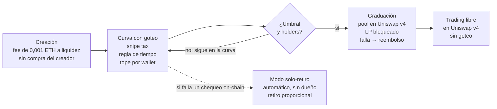
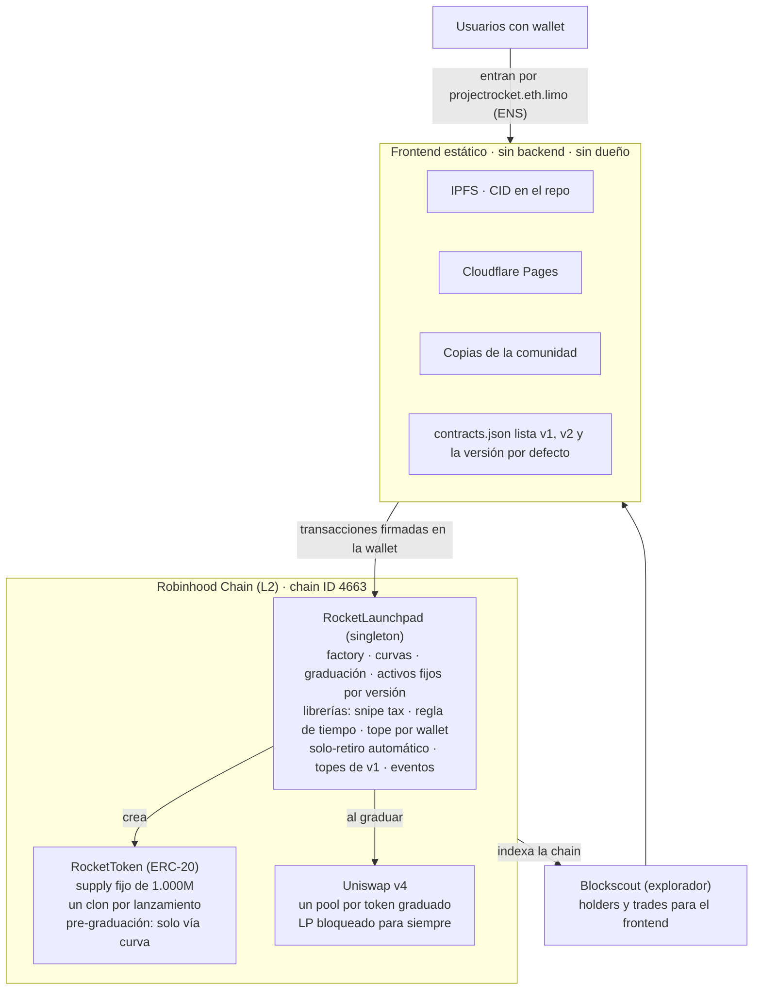

# Project Rocket — White Paper v0.1

Oct 20, 2026 · @AnthonyAsuaje

## Resumen

Project Rocket es un launchpad de tokens premium en Robinhood Chain donde solo gradúan los proyectos con comunidad real.

Cada token nace en una curva de bonding con tres reglas de "goteo" escritas en el contrato: frenan a los bots, castigan la venta agresiva y premian a quien mantiene. Un token gradúa al llegar a ~$250k de market cap con una base amplia de holders. En ese momento su liquidez pasa a Uniswap v4 y queda bloqueada para siempre.

El protocolo es abierto e inmutable. Son dos contratos sin llave de administrador y un frontend estático en IPFS que cualquiera puede alojar. Nadie lo opera: el desarrollador publica el código, pero no cobra fees ni puede pausar, cambiar ni administrar nada. Rocket Academy enseña a usarlo, a lanzar tokens y a desplegar instancias propias.

## El problema

Los launchpads actuales hacen fácil lanzar un token, pero no que sobreviva.

- **Graduación barata:** pump.fun gradúa a ~$69k de MC (MadeOnSol). Llegar ahí no prueba que exista una comunidad.
- **Snipers y bots:** compran en el primer bloque y venden sobre los compradores reales.
- **Vender y recomprar:** los primeros en entrar mueven el precio a su favor en ciclos cortos.
- **Concentración:** pocas ballenas controlan el supply y deciden el destino del token.
- **Confianza frágil:** en Robinhood Chain, Vlad.fun cerró por un problema interno de integridad de su equipo (TradingView).

El mercado existe: los memecoins se volvieron el uso dominante de Robinhood Chain a los pocos días de su lanzamiento (mismo artículo). Lo que falta es un filtro de calidad.

## La solución: Rocket

Project Rocket sube la vara de graduación y escribe las reglas anti-manipulación en el contrato, donde nadie puede saltearlas.

| Pilar | Qué hace |
|---|---|
| Graduación premium | Umbral de ~$250k de MC (≈3,6× pump.fun) y una base mínima de holders |
| Goteo | Tres reglas on-chain: frenan bots, castigan la venta agresiva y premian la tenencia |
| Holders medianos | Tope por wallet durante la curva: muchos holders medianos en vez de pocas ballenas |
| Liquidez segura | Al graduar, la liquidez pasa a Uniswap v4 y queda bloqueada para siempre |
| Código abierto | Contratos inmutables con licencia MIT, sin operador ni permisos especiales; frontend en IPFS que cualquiera puede alojar |
| Rocket Academy | Tutoriales para usar, lanzar y desplegar instancias propias de Project Rocket |

La promesa al trader: un token graduado en Project Rocket ya pasó un filtro duro de demanda, tiempo y distribución.

## Ciclo de vida de un token

Todo token pasa por las mismas etapas y las mismas reglas, incluido el token de la plataforma.

**Solo gradúa el token que junta liquidez y holders** — del lanzamiento al trading libre, con salida de emergencia.

*Ciclo de vida de un token · 4 etapas, 1 decisión*

El creador no tiene compra privilegiada: si quiere tokens, compra en la curva como cualquiera, con snipe tax y tope del 2%. Su incentivo es el 50% de la fee de trading.

Mientras no cumple el umbral y la base de holders, el token sigue en la curva con el goteo activo. El modo solo-retiro se activa automáticamente si falla un chequeo on-chain: frena compras, nunca retiros.

## Reglas de goteo

El MVP usa exactamente tres reglas. Cada una es una librería interna de Solidity con su propio archivo y sus propios tests, y se aplica en cada compra o venta durante la curva.

| # | Regla | Cómo funciona (valores iniciales, a calibrar) | Qué logra |
|---|---|---|---|
| 1 | Snipe tax decreciente | Fee alta al abrir la curva que baja con el tiempo: 50% → 1% en ~3 min (ZXOAR usa este modelo) | Saca a los bots del primer bloque |
| 2 | Regla de tiempo | Lock de venta de 30 min desde la última compra, sobre toda la tenencia (cada compra lo reinicia). Cooldown de 30 min entre vender y recomprar, mientras dure la curva. Fee de venta que baja con la antigüedad de la tenencia (ej. 5% → 1% en 7 días) | Castiga la venta agresiva y premia mantener |
| 3 | Tope por wallet | Ninguna wallet supera el 2% del supply mientras el token está en la curva | Favorece muchos holders medianos |

**Diseño de la regla 2:** el lock, el cooldown y la fee por antigüedad usan el mismo dato: marcas de tiempo por wallet. Por eso viven en una sola librería. La antigüedad se mide con el tiempo promedio ponderado de compra, para no castigar a quien acumula de a poco. El modo solo-retiro y los reembolsos saltean el lock, para que nadie quede atrapado en una emergencia.

**Las penalidades premian a los que se quedan:** el snipe tax y la fee de venta temprana van completas a la liquidez que se migra al graduar. El que vende rápido financia el respaldo de los que mantienen.

**Goteo por beneficiario:** las reglas se aplican a la wallet que recibe y tiene los tokens, no al contrato que llama. Así nadie las esquiva comprando por un router o agregador, y un router no bloquea a todos sus usuarios.

**Límite conocido:** los topes por wallet se pueden evadir con muchas wallets (ataque Sybil). Por eso la defensa principal es económica (fees y tiempos) y no por dirección.

**Las reglas terminan al graduar:** después, el token opera libre en Uniswap v4.

## Graduación

Un token gradúa cuando cumple dos condiciones: junta la liquidez objetivo en la curva y tiene una base de holders sana.

**Condiciones (propuesta)**

- **Liquidez:** la curva junta 20 ETH, fijos en ETH y sin oráculo. Con ETH a ~$2.400 equivale a ~$250k de MC; el MC en USD varía con el precio de ETH.
- **Holders:** al menos 300 holders y el top 10 con menos del 30% del supply.

**Supply y curva**

- Supply fijo de 1.000 millones por token.
- ~80% se vende en la curva y el resto va a la liquidez del pool al graduar (modelo pump.fun/Pons).
- Curva constant-product con reservas virtuales (como pump.fun): el precio es función del supply vendido. Se eligió sobre una curva S porque la matemática es simple, hay código auditado de referencia y evita el riesgo de precisión de `exp`/`ln` en punto fijo. La curva S queda descartada.

**Calibración: 20 ETH ≈ $250k**

- En pump.fun, ~85 SOL equivalen a ~$69k de MC: unas 5 veces lo juntado (MadeOnSol).
- Con 800M tokens en la curva, el MC final ≈ ETH juntado × r / 0,8, donde r = reserva virtual final / inicial.
- Con 20 ETH y r ≈ 4,17 (reserva virtual inicial ≈ 6,3 ETH), el MC final ≈ 104 ETH ≈ $250k con ETH a ~$2.400 (CoinGecko).
- Valores de partida: se ajustan en la simulación de las semanas 3–4 para que el precio final de la curva coincida con el precio inicial del pool en Uniswap v4.

**Qué pasa al graduar**

1. Cualquiera puede llamar a `graduate()`: no depende del equipo.
2. La liquidez, las penalidades y las fees de creación acumuladas crean un pool en Uniswap v4. **Pendiente:** con 20 ETH y los 200M tokens restantes, el pool arrancaría por debajo del precio final de la curva (harían falta ~20,9 ETH). La propuesta, a confirmar en la simulación, es depositar todo el ETH y solo los tokens necesarios para igualar el precio, y quemar el sobrante.
3. La posición de liquidez queda en poder del contrato, sin función de retiro ni de cobro: bloqueada para siempre.
4. Las fees que genera el pool quedan dentro de esa posición y nadie las puede cobrar, ni el creador ni el desarrollador. Es la opción más simple: menos código, menos superficie de ataque y ningún beneficiario.
5. Si la migración falla, se puede reintentar. Si sigue fallando después de 1 día, se habilitan reembolsos proporcionales.

## Arquitectura técnica

Project Rocket son dos contratos inmutables en Robinhood Chain y un frontend estático que solo los lee y firma transacciones. Ninguna función tiene dueño: no hay onlyOwner, pausa manual ni parámetros editables.

**Dos contratos inmutables; el frontend es solo una ventana**

*Arquitectura de Project Rocket · 2 contratos, frontend estático, 2 servicios (sin oráculo en el MVP)*

El usuario firma con su wallet. El frontend, esté en IPFS, en Cloudflare o en una copia, habla directo con los contratos. Los datos para mostrar (holders, trades, ranking) salen de los eventos on-chain y de Blockscout.

**Decisiones de diseño**

- **Dos contratos, lógica modular:** cada regla de goteo es una librería interna con sus propios tests. En la chain queda un solo contrato. Se diseña para el límite estándar de 24 KB (EIP-170), aunque Robinhood Chain pudiera permitir más, para que los forks funcionen en otras chains. Si se supera, la graduación pasa a un tercer contrato, `RocketGraduator`, también inmutable y sin admin.
- **Singleton:** una instancia lleva todas las curvas, como pump.fun o el PoolManager de Uniswap v4. Crear un token es más barato y hay menos llamadas entre contratos.
- **Token sin atajos:** antes de graduar, el token solo se mueve con la curva. Así nadie arma un pool externo para saltearse el goteo.
- **ERC-20 clásico al graduar:** `graduate()` activa un interruptor sin vuelta atrás y sin dueño. Desde ahí el token es un ERC-20 normal: sin fees, locks ni topes.
- **Sin hook post-graduación en el MVP:** el pool de Uniswap v4 no lleva lógica extra. Las reglas terminan al graduar.
- **Eventos ricos:** cada compra, venta, penalidad y graduación emite un evento. El frontend no necesita backend.
- **Stack:** Solidity + Foundry + OpenZeppelin; frontend Vite + wagmi/viem + RainbowKit; RPC público.
- **La chain:** L2 sobre Arbitrum Orbit, chain ID 4663, gas en ETH, bloques de ~100 ms, con Uniswap v4 y Chainlink desplegados (Wublock, Autheo, Bitquery).

## Activos de contrapartida

El MVP opera solo con ETH, pero el contrato nace preparado para sumar otros activos sin reescribirse.

**Diseño desde el día 1**

- **WETH por dentro:** el usuario paga en ETH, el contrato lo envuelve en WETH (ERC-20). Así la lógica sirve para cualquier ERC-20.
- **Activo por curva:** cada curva guarda su activo de contrapartida como parámetro, no fijo en el código.
- **Lista de activos permitidos por versión:** queda fija en cada versión; nadie puede agregar, quitar ni cambiar activos.
- **Umbral por activo:** 20 ETH no equivalen a 20 de otro activo. Cada activo tiene su umbral fijo, o un oráculo Chainlink que normaliza a USD con control de precios viejos.
- **Sin tokens raros:** no se aceptan tokens con fee al transferir ni con saldos que cambian solos (rompen la contabilidad).

**Sin curador:** la lista de activos de cada versión se fija en el deploy y no cambia. Sumar un activo nuevo es lanzar una versión nueva del contrato.

| Activo | Cuándo | Dificultad | Riesgo principal |
|---|---|---|---|
| ETH (WETH) | MVP | — | — |
| USDG / stablecoins | Post-MVP | Fácil | Bajo |
| Token de la plataforma | Post-MVP | Fácil | Circularidad y manipulación (ver sección siguiente) |
| Acciones tokenizadas (TSLA, NVDA) | Tras la consulta legal | Media | Legal: valores negociables; posibles restricciones de transferencia |

Ya es técnicamente posible en la chain: Pons permite cotizar lanzamientos en ETH, USDG o acciones tokenizadas (Bitquery).

## Token de la plataforma

El token de Project Rocket (nombre provisional: $ROCKET) se lanza en la propia plataforma, con las mismas reglas que cualquier otro token. No existe en el MVP.

**Lanzamiento justo**

- Sin preventa ni reserva oculta para el equipo.
- El desarrollador no compra en el lanzamiento ni cobra fees de creador: las fees de creador de $ROCKET van a la liquidez de graduación de $ROCKET.
- Pasa por la misma curva, las mismas reglas de goteo y la misma graduación. Si no gradúa, no se usa.

**Cómo se convierte en activo de contrapartida**

1. $ROCKET gradúa y su liquidez queda bloqueada en Uniswap v4.
2. Se espera un período de estabilidad: liquidez mínima y X días de historial de precio.
3. Una versión nueva del contrato lo incluye como activo de contrapartida (no hay curador).
4. Los creadores pueden elegir $ROCKET como contrapartida de sus curvas.

**Riesgos a mitigar**

| Riesgo | Mitigación |
|---|---|
| Circularidad: si $ROCKET cae, caen todas las curvas cotizadas en él | Umbral de graduación fijo en $ROCKET y límite de curvas activas en ese activo |
| Manipulación: con poca liquidez, inflar $ROCKET acelera graduaciones | Agregarlo solo con liquidez profunda; no usar precios spot del propio pool |
| Sin oráculo Chainlink para $ROCKET | Umbral en unidades del token, no en USD |
| Legal: un token de plataforma puede tratarse como valor negociable | Consulta legal antes del lanzamiento |

## Seguridad, versionado y contingencia

Como los contratos no se pueden parchear, la seguridad se diseña antes del deploy y las mejoras llegan como versiones nuevas.

**Seguridad a costo casi $0**

- Base auditada: OpenZeppelin, OpenZeppelin Uniswap Hooks y forks de launchpads auditados con licencia compatible con MIT (MIT, BSD o Apache-2.0), conservando sus avisos de copyright. Lo que se modifica pierde la auditoría y pasa por el mismo análisis que el código propio.
- Análisis automático en cada commit: Slither, Aderyn y fuzz/invariant tests de Foundry.
- Revisión comunitaria: postulación a CodeHawks First Flights.
- Protección contra reentrancy en todas las funciones que mueven fondos.
- Beta v1 con topes fijados en el código, sin listas de invitados: como máximo 100 ETH entre todas las curvas y 0,5 ETH por compra. Nadie puede subirlos; si se llena el tope global, las compras esperan a que una curva gradúe. v2 los quita con un deploy nuevo. La auditoría paga se financia con grants o donaciones.
- Bug bounty financiado con grants o donaciones: el protocolo no tiene tesorería.

**Mecanismos que van en el contrato desde v1 (después no se pueden agregar)**

1. **Modo solo-retiro automático:** el contrato verifica que su saldo real cubra lo que tiene contabilizado. Si el chequeo falla, cualquiera puede activar el modo y nadie puede apagarlo. Frena compras, nunca retiros.
2. **Retiro proporcional:** en modo solo-retiro, cada holder devuelve sus tokens y recupera su parte de la curva.
3. **Graduación reintentable y con reembolso** si falla por 1 día.
4. **Control de oráculo:** no aplica al MVP (umbral fijo en ETH, sin oráculo). Entra con Chainlink en la versión que sume otro activo: se rechazan precios viejos o fuera de rango.
5. **Eventos ricos:** el frontend detecta estados anómalos y avisa.

**Sin fondo de seguridad:** un fondo acumulado dentro del contrato es una bolsa que alguien termina queriendo administrar, y eso va contra la idea de un protocolo sin operador. Esa parte de la fee va a la liquidez del token. Si se activa el modo solo-retiro, cada holder recupera su parte proporcional de lo que realmente hay en la curva.

**Versionado: versiones nuevas, nunca parches**

- Cada versión es un contrato independiente. v2 no llama a v1 ni depende de él.
- Los tokens de v1 conservan sus reglas para siempre. Los lanzamientos nuevos usan la última versión.
- El frontend une las versiones con una lista (`contracts.json`: v1, v2 y la versión por defecto).
- Si v2 falla, se publica un frontend nuevo con v1 por defecto. Los holders de v2 usan el retiro proporcional.
- Cada versión nueva sale primero en testnet y después en mainnet con topes, con v1 disponible como plan B.

## Descentralización y Rocket Academy

Project Rocket no depende de su creador para funcionar: el código es público e inmutable, y Rocket Academy enseña a cualquiera a usarlo y replicarlo.

**Descentralización**

- **Licencia MIT:** cualquiera puede leer, auditar y forkear el código.
- **Sin llave de administrador:** los parámetros se fijan en el deploy. Sin excepciones: nadie puede pausar, cambiar parámetros ni agregar activos.
- **Creación abierta:** cualquier persona crea tokens sin permiso.
- **Frontend replicable:** build estático publicado en IPFS (cada versión tiene su CID) y en Cloudflare Pages. La entrada canónica es projectrocket.eth (ENS), que se abre como projectrocket.eth.limo en cualquier navegador. pages.dev queda como espejo gratuito. El CID de cada versión se publica en el repo para evitar copias falsas.
- **Sin backend propio:** el frontend lee los contratos y los eventos on-chain, más la API de Blockscout. No guarda claves secretas.
- **Sin token de gobernanza en el MVP:** las reglas viven en el código, no en votos.

**Nombre ENS: projectrocket.eth**

Project Rocket usa un nombre ENS en vez de un dominio tradicional: es más barato, vive on-chain y encaja con un frontend en IPFS.

- **Costo:** $5 por año pagados en ETH, por ser un nombre de 5 o más caracteres (ENS), más el gas de 2 transacciones en Ethereum mainnet. Conviene registrarlo por varios años de una vez.
- **Acceso:** `projectrocket.eth.limo` o `projectrocket.eth.link` en cualquier navegador, gratis y sin configurar nada (eth.limo). Brave abre `projectrocket.eth` directo.
- **Actualizaciones sin gas:** el registro Content Hash apunta una sola vez a un nombre IPNS (ENS). Cada versión nueva del frontend se publica en IPNS, sin pagar gas.
- **Renovación abierta:** cualquiera puede renovar un nombre .eth, no solo su dueño. La comunidad puede mantenerlo activo.
- **Alcance del control:** el nombre solo apunta al frontend; no da ningún permiso sobre los contratos. Cada CID se sigue publicando en el repo.
- **Comprado y listo para usar:** `projectrocket.eth` ya es del proyecto. Rocket Academy usa el subdominio `academy.projectrocket.eth`, que solo cuesta el gas de crearlo.

**Rocket Academy**

En v1, Rocket Academy sale como una invitación a aprender: explica el protocolo y cómo usarlo, pero todavía no es una guía de desarrollo. Los módulos para desplegar y auditar forks, el Starter Kit y el certificado llegan después del MVP.

| # | Módulo | Resultado del alumno | Cuándo |
|---|---|---|---|
| 1 | Cómo funciona Project Rocket | Entiende curva, goteo y graduación | v1 |
| 2 | Lanzá tu token | Token creado en testnet | v1 |
| 3 | Desplegá tu propio Project Rocket | Contratos y frontend propios en testnet (chain ID 46630) | Post-MVP |
| 4 | Seguridad básica | Corre Slither, Aderyn y fuzzing en su fork | Post-MVP |
| 5 | Comunidad: del lanzamiento a la graduación | Plan de comunidad propio | Post-MVP |

- **Formato ($0):** docs en VitePress publicados en IPFS (entrada `academy.projectrocket.eth` vía Content Hash), videos en YouTube y soporte en Discord.
- **Starter Kit (post-MVP):** repo plantilla + scripts de deploy de contratos y frontend.
- **Incentivos (post-MVP):** certificado on-chain no transferible al completar el módulo 3, galería pública de forks y contenido de alumnos destacado.
- **Aporte voluntario:** los forks no le pagan nada a Project Rocket. Quien quiera apoyar el proyecto puede donar a una dirección pública, separada del protocolo.

## Modelo económico

El protocolo no tiene tesorería ni cobra para el desarrollador. Cada fee queda dentro del sistema: va al creador del token o a la liquidez que respalda a los holders. La plataforma cobra 0%, y el frontend oficial tampoco cobra fee de interfaz. Lo único que se paga aparte es el gas de la red.

| Fee | Monto | Destino |
|---|---|---|
| Fee de trading en la curva | 1% por operación | 50% creador del token · 50% liquidez de graduación (respalda a todos los holders) |
| Fee de creación | 0,001 ETH fija | 100% a la liquidez de graduación del propio token; filtra el spam sin que nadie gane con eso |
| Snipe tax y fee de venta temprana | Variable | 100% a la liquidez del pool al graduar |
| Fees del pool Uniswap v4 post-graduación | Fee del pool | Quedan dentro de la posición bloqueada; nadie las cobra |
| Gas (incluido el de crear el token) | Lo que cobra la red | Robinhood Chain; lo paga quien firma la transacción |

**Lo que no existe en el código, en ninguna versión**

- Fees para la plataforma o para el desarrollador.
- Wallets del equipo o tesorería.
- Fondos acumulados que alguien pueda administrar.
- Funciones para cambiar a dónde van las fees.

**Cómo se financia el desarrollo:** con grants del ecosistema y donaciones voluntarias a una dirección pública, separada del protocolo. Robinhood aportó $1M al Arbitrum Open House 2026 (Robinhood), y su CEO anunció más inversión en builders, con detalles pendientes (KuCoin). Para la auditoría se apunta al Uniswap Foundation Security Fund, al programa de Arbitrum y a los grants de Zealynx.

## Hoja de ruta

v1 sale como beta en mainnet el 10 ene 2027, tras 12 semanas y 4 gates de decisión. El MVP cuesta hasta ~US$1.200: consulta legal de hasta $800, gas de deploy de hasta $200 y ~$200 de margen para imprevistos (el ENS ya está comprado). El detalle paso a paso está en [guia-de-arranque.md](guia-de-arranque.md).

**MVP: v1 (20 oct 2026 → 10 ene 2027)**

0. **Día 0 (20–21 oct):** herramientas, cuentas y repo público con licencia MIT.
1. **Definición y validación (sem 1–2):** entrevistas, análisis de la competencia, consulta legal y landing con waitlist. Gate 1: al menos 5 de 10 entrevistados valoran el goteo, al menos 50 personas en la waitlist y ningún bloqueo legal.
2. **Diseño de mecánica (sem 3–4):** calibración de la curva (20 ETH ≈ $250k), simulación de ataques, verificación matemática de la graduación y spec en el repo. Gate 2: parámetros fijados, la simulación muestra que el sniper pierde plata y la matemática de la graduación cierra (el precio del pool coincide con el final de la curva).
3. **Construcción (sem 5–8):** 2 contratos + librerías de reglas, frontend estático y deploy en testnet. Gate 3: el ciclo completo funciona en testnet, con una graduación probada usando al menos 300 wallets.
4. **Seguridad y beta (sem 9–10):** Slither, Aderyn, fuzzing, revisión comunitaria y beta en testnet. Gate 4: cero bugs críticos o altos abiertos y 20 transacciones de testers reales en testnet sin fallas.
5. **Lanzamiento (sem 11–12):** mainnet v1 con topes fijados en el código y Rocket Academy como invitación a aprender (módulos 1–2).

**Cómo medimos el éxito:** tokens creados, tasa de graduación, holders al graduar, % del supply comprado por snipers en los primeros 5 minutos, holders retenidos a 7 días, MC a 30 días de la graduación, alumnos de Rocket Academy e incidentes.

**Después del MVP** (hasta ~US$25k, financiados con grants y donaciones)

1. **v2 abierta (meses 3–6):** auditoría paga (hasta $15k) con un auditor independiente y bounty propio en GitHub, financiados con grants o donaciones; v2 es un deploy nuevo sin topes.
2. **Rocket Academy completa (meses 3–6):** módulos 3–5, Starter Kit y certificado on-chain.
3. **Stablecoins (meses 6–12):** USDG como activo de contrapartida.
4. **$ROCKET (meses 6–12):** lanzamiento en la plataforma y, tras su período de estabilidad, una versión nueva lo incluye como activo de contrapartida.
5. **v3 (meses 6–12):** criterio de holders afinado, alertas y perfiles verificados.
6. **Acciones tokenizadas:** solo con aval legal, sin fecha.
7. **Integraciones:** con tracción, pedir a FOMO que integre los tokens graduados.

## Marco legal, riesgos y aviso

Los dos riesgos críticos son un exploit en los contratos y un problema regulatorio. Ambos se trabajan antes de mainnet.

**Marco legal (Argentina)**

- Quien preste servicios con activos virtuales desde Argentina debe inscribirse en el Registro PSAV de la CNV antes de operar (CNV).
- Desde la RG 1172/2026 (vigente desde el 16 oct 2026), un protocolo descentralizado queda afuera solo si nadie ejerce control o influencia suficiente sobre su funcionamiento (Contadores en Red, Allende & Brea). La doctrina menciona como indicios de influencia las claves de administración, la gobernanza concentrada, los frontends y el cobro de comisiones.
- Por eso el protocolo cobra 0% para la plataforma en todas sus versiones, y el frontend oficial tampoco cobra fee de interfaz.
- Por eso Project Rocket se diseña sin operador: sin fees para el desarrollador, sin tesorería, sin curador y sin pausa manual. El nombre ENS solo apunta al frontend y no da control sobre los contratos.
- Quien decide si existe control o influencia es la CNV, no el diseño. La consulta legal sigue en el roadmap.
- Precedente: en EE.UU., el desarrollador de Tornado Cash fue condenado en 2025 por un cargo, aunque el protocolo no era custodial (Mayer Brown).
- Acciones tokenizadas y $ROCKET requieren análisis legal propio.

**Riesgos**

| Riesgo | Mitigación |
|---|---|
| Exploit en contratos | Base auditada, análisis automático, beta v1 con topes (100 ETH en curvas, 0,5 ETH por compra) y modo solo-retiro automático |
| Umbral alto: pocos tokens gradúan | Simulación previa y ajuste de la curva |
| Competencia: Pons domina la chain (CryptoTicker) | Marca premium y métricas públicas de calidad |
| Ataques Sybil contra los topes por wallet | Defensas económicas (fees y tiempos) |
| Secuenciador centralizado: Robinhood aplica screening de compliance (Wublock) | Asumido como regla del entorno |
| Copias falsas del frontend (phishing) | projectrocket.eth como entrada canónica y CID de cada versión publicado en el repo |

**Aviso:** este documento describe un proyecto en desarrollo. No es una oferta de valores ni asesoramiento financiero o legal. Los parámetros pueden cambiar. Operar con tokens implica riesgo de pérdida total.

## Fuentes

- Robinhood — mainnet de Robinhood Chain
- Robinhood — testnet y $1M para builders
- Wublock — guía de Robinhood Chain
- QuickNode — compatibilidad EVM
- Bitquery — Pons API
- CryptoTicker — memecoins en Robinhood Chain
- TradingView — cierre de Vlad.fun
- ZXOAR — anti-snipe con hook v4
- MadeOnSol — graduación en pump.fun · mecánica de pump.fun
- CoinGecko — precio de ETH
- OpenZeppelin Uniswap Hooks
- Slither · Aderyn · CodeHawks First Flights
- IPFS — deploy con GitHub Actions
- KuCoin — Tenev sobre inversión en builders
- CNV — Registro PSAV · RG 1172/2026
- Contadores en Red — RG 1172/2026, excepción por control o influencia
- Mayer Brown — veredicto del caso Tornado Cash
- ENS — precios de registro · ciclo de vida de un .eth · sitio descentralizado con Content Hash
- eth.limo — gateway ENS + IPFS/IPNS
